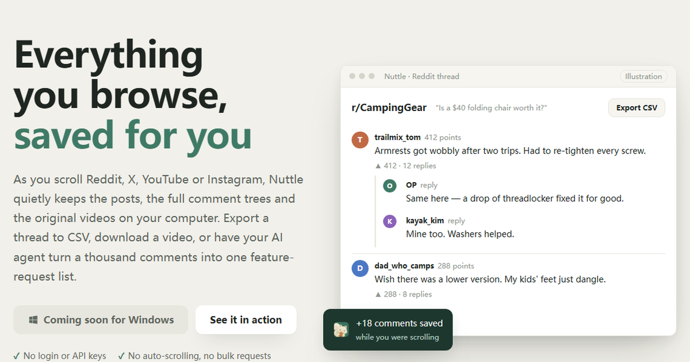

<p align="center"></p>

<h1 align="center">Nuttle</h1>

<p align="center"><b>Everything you browse, saved for you — and one question away for your AI agent.</b><br>
Export Reddit comments with every nested reply · Save X posts and replies · Download the videos you watched · Query it all from Claude Code over MCP</p>

<p align="center"><a href="https://nuttle.dev/en/"><b>nuttle.dev</b></a> · <a href="https://nuttle.dev/en/claude-code-mcp/">Claude Code MCP guide</a> · <a href="README.zh-CN.md">中文</a></p>

<p align="center"></p>

As you scroll Reddit, X, YouTube or Instagram, Nuttle quietly keeps the posts, the full comment trees and the original videos on your computer. Export a thread to CSV, download a video, or have your AI agent turn a thousand comments into one feature-request list.

- ✓ No login or API keys　✓ No auto-scrolling, no bulk requests　✓ Data stays on your machine

## What it does

- **Export Reddit comments — every nested reply included.** Open a thread and scroll; one click to CSV.
- **Save X posts and their replies** — text, metrics, replies and images, searchable.
- **Download the videos you watched** as original files; Reddit's split audio and video are merged for you.
- **A thousand comments, one feature-request list.** Hand a scope to your own AI agent (Claude Code, Codex, any MCP client); every quote links back to the original comment.
- Filter and sort · export to CSV · star and tag · back to the source · capture any website with Discover.

## Use it with Claude Code or any MCP client

Nuttle runs a local MCP server (streamable HTTP, localhost only) while the app is open:

```bash
claude mcp add --transport http nuttle http://127.0.0.1:8787/mcp
```

Or install the Claude Code plugin — same connection, plus a skill that turns any site you browsed into a reusable mapping card:

```bash
claude plugin marketplace add shiyue1250/nuttle-registry
claude plugin install nuttle@nuttle
```

Claude Desktop (and other clients that only launch local commands) use the [`nuttle-mcp`](mcp/) bridge in `claude_desktop_config.json`:

```json
{ "mcpServers": { "nuttle": { "command": "npx", "args": ["-y", "nuttle-mcp"] } } }
```

Other clients (Cursor, Codex, …) point at `http://127.0.0.1:8787/mcp`; for Codex add `[mcp_servers.nuttle]` with `url = "http://127.0.0.1:8787/mcp"` to `~/.codex/config.toml`.

Then ask things like:

- *"What did people complain about in the Reddit threads I read today?"*
- *"Wait while I scroll this thread, then summarize the replies."*
- *"Group these comments into feature requests, with quotes."*
- *"Download the videos from those posts."*

32 tools cover a post with its full comment tree in one call, waiting for new data while you scroll, raw captures from any site (with code-free field mapping), media downloads, and insight jobs whose quotes are checked against the captured comments. Tags you set yourself can't be overwritten by the agent. Guide: [nuttle.dev/en/claude-code-mcp](https://nuttle.dev/en/claude-code-mcp/)

## Supported sites

Reddit · X · YouTube · Instagram · Amazon · Xiaohongshu (RedNote) · WeChat Channels · WeChat articles · Douyin · Kuaishou · Bilibili — plus any other site through Discover.

## Get started

1. [Download for Windows](https://nuttle.dev/download/windows?src=github) (about 6 MB, no sign-up), or from [nuttle.dev](https://nuttle.dev/en/)
2. Turn on the sites you want under Plugins
3. Browse as usual — come back to Nuttle and it's all there

## FAQ

**Will my account get banned?** Nuttle sends no extra requests and never scrolls for you; it only keeps what the page already loaded while you browsed, the same as you scrolling yourself. Platform rules are up to each platform, and we can't guarantee them.

**Is anything uploaded?** No. Everything lives in a local database on your computer, and there's no account. The MCP server only listens on localhost; what your agent reads is passed to its model like any other tool result.

**Which AI agents work?** Claude Code, Codex and any MCP client that supports streamable HTTP.

**Mac?** Windows first; Mac is in the works.

**Is it open source?** The app is free and closed source. The Claude Code plugin and the mapping cards are public at [shiyue1250/nuttle-registry](https://github.com/shiyue1250/nuttle-registry).
