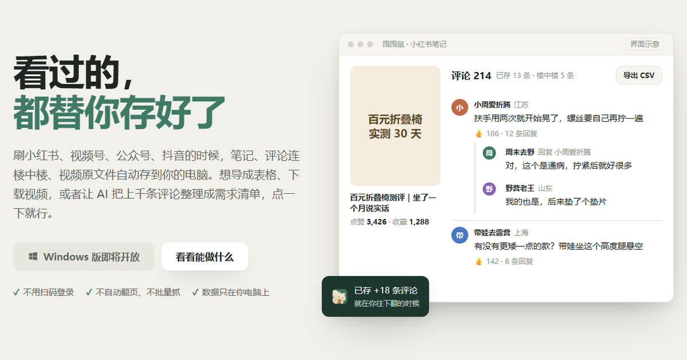

<h1 align="center">囤囤鼠 Nuttle</h1>

<b>看过的，都替你存好了。</b> 
小红书评论导出 · 公众号文章与留言保存 · 视频号视频下载 · 评论整理成需求清单

<a href="https://nuttle.dev"><b>官网 nuttle.dev</b></a> · <a href="README.md">English</a>

刷小红书、视频号、公众号、抖音的时候，笔记、评论连楼中楼、视频原文件自动存到你的电脑。想导成表格、下载视频，或者让 AI 把上千条评论整理成需求清单，点一下就行。

- ✓ 不用扫码登录　✓ 不自动翻页、不批量抓　✓ 数据只在你电脑上

## 能做什么

### 小红书评论导出，楼中楼一条不漏
打开笔记往下翻，评论和回复（含 IP 属地、点赞数）自动存好，一键导出 CSV，Excel、WPS、飞书表格都能打开。

### 公众号文章、留言、阅读数，一起存下来
在电脑版微信里打开文章，正文排版、配图、读者留言（含回复）和阅读 / 赞 / 在看数自动保存，适合拆解爆文、行业文章留档。

### 视频号、抖音、小红书视频，看过就能下原文件
看过的视频都在列表里，点下载就是原文件；视频号视频下好就能播，Reddit 画面与声音分开的视频自动合成。

### 上千条评论，变成一张需求清单
选好范围（平台、时间、收藏的内容），交给你自己的 AI（Claude Code、Codex 等）做需求发现、痛点归类或评论总结；结论里的每句原话都能点回原评论核对。

### 存下来之后
- 按点赞、时间、作者、IP 属地筛选排序
- 按当前筛选导出 CSV
- 收藏与标签
- 每条内容记着原文链接，一键回原文
- 没有插件的网站，打开「发现」也能先存下来

## 支持的平台

小红书 · 微信视频号 · 公众号 · 抖音 · 快手 · B 站 · X · Reddit · YouTube · Instagram · Amazon

## 三步上手

1. [下载 Windows 版](https://nuttle.dev/download/windows?src=github)（十几 MB，不用注册；也可以到官网 [nuttle.dev](https://nuttle.dev)）
2. 在「插件」里点一下安装要存的平台
3. 照常浏览，回到囤囤鼠，看过的内容都在

## 常见问题

**会不会被封号？** 囤囤鼠不额外发请求、不自动翻页，只保存你浏览时页面本来就加载出来的内容，行为和你自己刷一样。平台规则由平台决定，我们无法替平台做保证。

**数据会上传吗？** 不会。全部存在你电脑上的本地数据库里，没有账号。

**视频号和公众号怎么保存？** 在电脑版微信里正常观看即可；第一次使用需要在设置里装一次本机证书。

**能接哪些 AI？** Claude Code、Codex 以及任何支持 MCP 的 AI 客户端。

**支持 Mac 吗？** 先开放 Windows 版，Mac 版在准备中。
